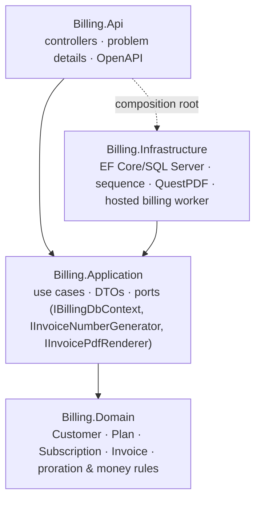

# Billing Service

[](https://github.com/Al7assan1999/billing-service/actions/workflows/ci.yml)

A subscription billing API in **ASP.NET Core (.NET 10)** with **EF Core** on **SQL Server**: customers subscribe to monthly plans, invoices are issued automatically with VAT, upgrades are prorated to the day, payments are tracked, and invoices render as PDF.

Structured with **Clean Architecture** and a rich **domain model**; tested with unit tests on the domain and integration tests against a real SQL Server container.

## Features

- **Subscriptions billed in advance**: starting a subscription issues the first month's invoice; a scheduled **billing run** renews every due subscription and invoices the next period.
- **Idempotent billing runs**: running twice on the same day issues nothing new, guaranteed by the domain *and* a filtered unique index on `(SubscriptionId, PeriodStart)`. A run after downtime catches up period by period.
- **Proration**: changing plan mid-period credits the unused days at the old price and charges them at the new price, on one invoice.
- **VAT**: configurable rate (default 15%, the Saudi standard rate), rounded half away from zero to 2 decimals.
- **Invoice lifecycle**: `Draft → Issued → Paid` (partial payments supported) or `Void`; issued invoices are immutable; overpayments and voiding paid invoices are refused.
- **Invoice numbers** from a **SQL Server `SEQUENCE`** (`INV-2026-000042`): unique across concurrent requests and instances without a locked counter row.
- **PDF invoices** rendered with QuestPDF.
- **Dashboard endpoint**: MRR, outstanding and overdue amounts, revenue for the last 6 months.

## Architecture



Dependencies point inward: the domain has no dependencies at all, the application layer defines the ports it needs, and infrastructure implements them. Business rules live on the entities (`Subscription.ChangePlan`, `Invoice.RecordPayment`), so they're testable without a database.

## API

| Method | Route | Description |
|---|---|---|
| `POST` | `/api/customers` · `GET` `/api/customers` | Create / list customers |
| `POST` | `/api/plans` · `GET` `/api/plans` · `POST` `/api/plans/{id}/retire` | Manage plans |
| `POST` | `/api/subscriptions` | Start a subscription and issue the first invoice |
| `POST` | `/api/subscriptions/{id}/change-plan` | Switch plan now, issue a prorated invoice |
| `POST` | `/api/subscriptions/{id}/cancel` | Cancel (no further renewals) |
| `GET` | `/api/invoices?status=&overdue=&customerId=&page=&pageSize=` | Filtered, paged invoice list |
| `GET` | `/api/invoices/{id}` · `/api/invoices/{id}/pdf` | Invoice detail / PDF |
| `POST` | `/api/invoices/{id}/payments` · `/api/invoices/{id}/void` | Record a payment / void |
| `GET` | `/api/dashboard` | MRR, outstanding, overdue, revenue by month |
| `POST` | `/api/billing-runs?date=` | Run billing now (also runs hourly in the background) |

Errors are RFC 7807 problem details: `422` for business-rule violations (with the reason), `404` for unknown IDs, `409` for conflicting writes, `400` for invalid input.

Example: upgrading on the 11th of a 31-day period from a 100 SAR to a 200 SAR plan:

```json
{
  "status": "Issued",
  "lines": [
    { "description": "Unused time on Basic (2026-01-11 to 2026-02-01)", "amount": -67.74 },
    { "description": "Remaining time on Pro (2026-01-11 to 2026-02-01)", "amount": 135.48 }
  ],
  "subtotal": 67.74, "taxRate": 0.15, "tax": 10.16, "total": 77.90
}
```

## Running it

```bash
docker compose up --build
```

The API is on http://localhost:5200 (OpenAPI document at `/openapi/v1.json`); migrations run on startup.

Without Docker: point `ConnectionStrings:Billing` in `src/Billing.Api/appsettings.json` at a SQL Server instance and run `dotnet run --project src/Billing.Api`.

## Tests

```bash
dotnet test                          # domain unit tests; integration tests are skipped
RUN_DOCKER_TESTS=true dotnet test    # also runs the API against SQL Server (Testcontainers)
```

The integration tests boot the real API with `WebApplicationFactory`, give each test a fresh SQL Server database, and cover the whole lifecycle: first invoice → payment → monthly renewals → idempotent re-run → catch-up after downtime, proration, error responses, PDF output and dashboard figures. CI runs them on every push, plus a Docker Compose smoke test.

## License

MIT
